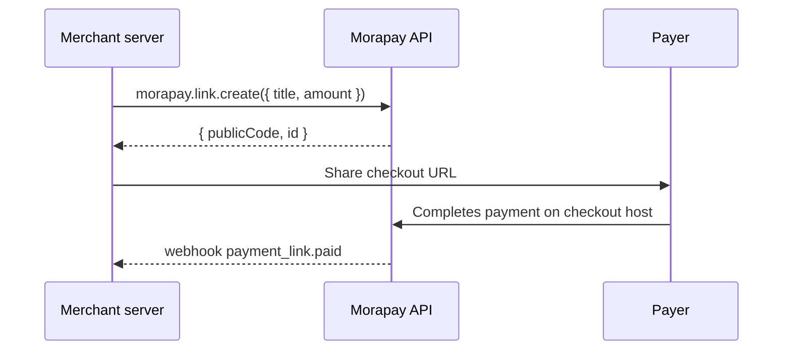

Payment links are fixed-amount checkout URLs you share with customers. The Merchant API exposes them at `/api/v1/merchant/links` with companion product catalog routes at `/products`.

## Why payment links

- **No custom checkout code** — share a URL or embed the hybrid widget
- **Per-customer links** — attach `customerEmail` and metadata from your CRM
- **Payment tracking** — `paidAt`, `paidByWalletAddress` on the link record

## Flow



## SDK reference

Callable pattern — list/get share one signature:

```typescript
const { data: links } = await morapay.link({ limit: 20 });
const link = await morapay.link("link_abc123");

const created = await morapay.link.create({
  title: "Consulting — March",
  amount: 250,
  currency: "USD",
});

const checkoutUrl = morapay.buildCheckoutUrl(created.publicCode);
```

### Products + per-customer links

```typescript
const product = await morapay.products.create({
  name: "Annual plan",
  price: 49,
  currency: "USD",
  type: "DIGITAL",
});

const checkout = await morapay.products.link(product.id, {
  customerEmail: "alex@example.com",
  customerExternalId: "user_123",
});

const paid = morapay.utils.isPaid(checkout); // false until payer completes
```

### Sessions & settlement quotes

```typescript
const sessions = await morapay.link.sessions("link_abc123", { limit: 10 });
const quote = await morapay.link.quote("link_abc123", { chainId: 8453 });
```

## Platform minimums

The API enforces minimum amounts per feature kind. Mobile money corridors may have **higher regional floors** (e.g. 1.00 GHS). Below-minimum amounts return `links.amount.below_minimum` — see [error code docs](/errors/codes/links-amount-below-minimum).

## Checkout integration

| Pattern | SDK helper |
|---------|------------|
| Hosted redirect | `morapay.buildCheckoutUrl(publicCode)` |
| Same-page modal | `morapay.buildPaymentLinkEmbedUrl(publicCode)` |
| Business QR | `morapay.qr.get()` → `buildBusinessPayCheckoutUrl(slug)` |

The checkout widget (`morapay-checkout.js`) uses a **hybrid architecture**: native Shadow DOM shell on your page + secure iframe canvas for card/MoMo/KYC flows.

## Webhook

When a link is paid, Morapay emits `payment_link.paid` to your configured endpoints. See [Webhooks](/developer-tools/webhooks).

## FAQ

<AccordionGroup>
  <Accordion title="What is the default minimum for payment links?">
    Platform default is **$1 USD equivalent** (`minPaymentLinkUsd` in platform settings). Regional MoMo floors may be higher.
  </Accordion>
  <Accordion title="Can I customize the vanity slug?">
    Yes on create/update. Duplicate slugs return `links.slug.duplicate` (HTTP 409).
  </Accordion>
  <Accordion title="How do I know if a customer paid?">
    Poll `morapay.link(id)` and check `paidAt`, use `morapay.utils.isPaid(link)`, or listen for `payment_link.paid` webhooks.
  </Accordion>
</AccordionGroup>

## Next step

[Subscriptions](/concepts/subscriptions) — recurring billing on top of the same Merchant API.
