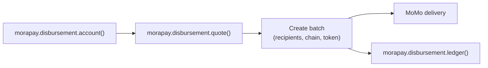

Morapay **disbursements** route merchant treasury liquidity to local mobile money (MoMo) wallets — MTN, Telecel, and other regional carriers. The Merchant API exposes this under `/api/v1/merchant/disbursement/*`; the SDK namespace is `morapay.disbursement`.

## Business value

Turn stablecoin or fiat treasury balance into **instant local payouts** without building carrier integrations yourself. Quote fees upfront, schedule one-time or recurring batches, and track ledger entries per business.

## Flow



## SDK reference

```typescript
const account = await morapay.disbursement.account();

const quote = await morapay.disbursement.quote({
  chainId: 8453,
  token: "USDC",
  payoutTotal: 250,
  recipientCount: 10,
});

const { data: batches } = await morapay.disbursement({ limit: 20 });
const batch = await morapay.disbursement("batch_xyz");

const { data: ledger } = await morapay.disbursement.ledger({ page: 1, limit: 50 });

await morapay.disbursement.cancel("batch_xyz");
```

### Batch creation (API)

Batches are created via `POST /disbursement/batches` with:

- `chainId`, `token` — settlement rail (validated per environment)
- `schedule` — `one_time` or `recurring`
- `recipients[]` — name, contact, payer account, amounts
- `usdCharge`, `payoutTotal`, `processingAt` — must match a prior quote

Deposits and withdrawals on the disbursement account accept an **`idempotencyKey`** (8–200 chars) to prevent duplicate ledger movements.

## Minimums & balances

| Check | Detail |
|-------|--------|
| Platform minimum | Default **$5 USD** for recurring/disbursement (`minRecurringUsd`) |
| Insufficient liquidity | `payouts.momo.insufficient_balance` |
| Carrier downtime | `payouts.network.carrier_down` — queue and retry |

Always call `morapay.disbursement.account()` before large batches.

## Webhook

`disbursement_batch.created` fires when a batch is accepted. Payout status changes may also arrive via `payout.status_updated`.

## FAQ

<AccordionGroup>
  <Accordion title="What are the minimum MoMo settlement amounts?">
    Platform USD minimums apply at quote time. Individual corridors (e.g. Ghana GHS) may enforce additional carrier floors — validate amounts client-side before submitting batches.
  </Accordion>
  <Accordion title="How do I handle network downtime?">
    Catch `payouts.network.carrier_down`, enqueue the batch for retry with backoff, and alert operations. Include `requestId` when contacting support.
  </Accordion>
</AccordionGroup>

## Next steps

<CardGroup cols={2}>
  <Card title="Disbursement tokens" icon="coins" href="/reference/disbursement-tokens">
    USDC on Base and Ethereum (LIVE) · Base Sepolia (TEST).
  </Card>
  <Card title="Payout timing" icon="clock" href="/reference/payout-timing">
    Minimums, batch scheduling, and MoMo vs bank SLAs.
  </Card>
  <Card title="Banks & MoMo" icon="building-columns" href="/reference/banks-and-momo">
    Withdrawal rails and operator catalogs.
  </Card>
  <Card title="Webhooks" icon="webhook" href="/developer-tools/webhooks">
    `disbursement_batch.created` and `payout.status_updated`.
  </Card>
</CardGroup>
