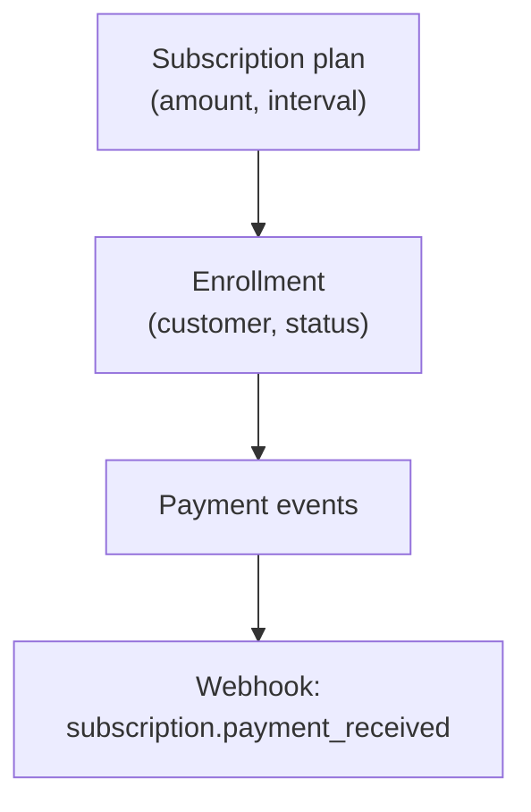

Subscriptions let merchants sell recurring access: SaaS seats, memberships, or installment plans through the Merchant API (`/api/v1/merchant/subscriptions`).

## Overview

| Concept | SDK access | API path |
|---------|------------|-----------|
| Plans | `morapay.subscriptions.plans()` | `GET/POST /subscriptions/plans` |
| Enrollments | `morapay.subscriptions()` | `GET/POST /subscriptions` |
| Lifecycle | `.pause(id)` / `.cancel(id)` | `POST /subscriptions/:id/pause` etc. |

Plans define price and interval. Subscriptions represent a customer enrolled in a plan.

## Create a plan and enroll

```typescript
const plan = await morapay.subscriptions.plans.create({
  name: "Pro monthly",
  amount: 29,
  currency: "USD",
  interval: "MONTH",
});

const subscription = await morapay.subscriptions.create({
  planId: plan.id,
  customerEmail: "alex@example.com",
});

const active = await morapay.subscriptions(subscription.id);
await morapay.subscriptions.pause(subscription.id);
```

List and get use the callable pattern:

```typescript
const { data: plans } = await morapay.subscriptions.plans({ limit: 10 });
const { data: subs } = await morapay.subscriptions({ status: "ACTIVE" });
```

## Architecture



Morapay handles billing orchestration, ledger entries, and notifications. Public checkout flows for subscriptions are served separately on the checkout host (payer-facing, no merchant keys).

## Webhook events

| Event | When |
|-------|------|
| `subscription.payment_received` | A subscription payment settles |

Full event list: [Webhooks](/developer-tools/webhooks).

## Platform minimums

Subscription charges enforce `minSubscriptionUsd` (default **$1 USD** equivalent).

## FAQ

<AccordionGroup>
  <Accordion title="Can I import existing subscribers?">
    Bulk import endpoints under `/subscriptions/imports` support dashboard-driven migrations. Contact support for large CSV imports.
  </Accordion>
  <Accordion title="What statuses can a subscription have?">
    Use the `status` filter on `morapay.subscriptions()`; values include `ACTIVE`, `PAUSED`, and terminal states returned by the API.
  </Accordion>
  <Accordion title="Do subscriptions use idempotency keys?">
    Merchant-initiated deposits to the subscription account accept an `idempotencyKey` in the request body. See [Idempotency](/developer-tools/idempotency).
  </Accordion>
</AccordionGroup>

## Next step

[Payouts & MoMo](/concepts/payouts-momo): disburse stablecoin liquidity to mobile money wallets.
