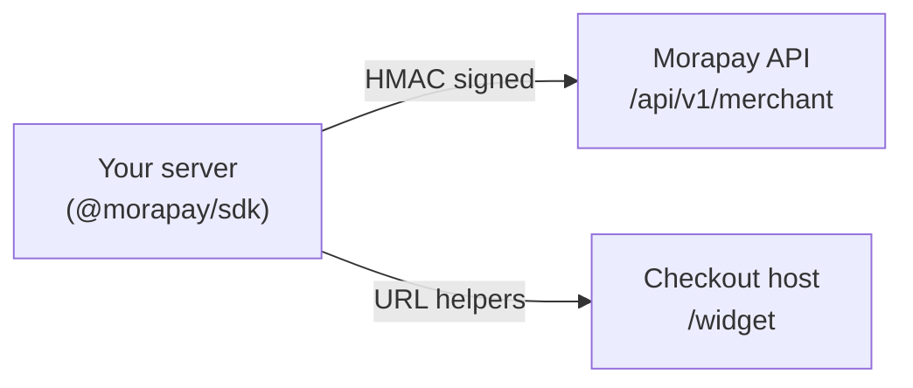

Morapay separates **TEST** and **LIVE** at the API key level. There is no environment header when using signed merchant keys.

## TEST vs LIVE

| | TEST | LIVE |
|---|------|------|
| Public key | `pk_test_*` | `pk_live_*` |
| Secret key | `sk_test_*` | `sk_live_*` |
| Funds | Simulated / sandbox rails | Real money movement |
| Dashboard | TEST mode toggle | LIVE mode toggle |

Use TEST keys for integration development. Rotate to LIVE only after checkout, webhooks, and payout flows are verified.

## API hosts

| Service | Production default | Local dev |
|---------|-------------------|-----------|
| **Morapay API** (Merchant API) | `https://api.morapay.io`
| **Checkout** (hosted + widget) | `https://checkout.morapay.io` | `http://localhost:3002` |

SDK options:

```typescript
const morapay = new Morapay({
  publicKey: process.env.MORAPAY_PUBLIC_KEY!,
  secretKey: process.env.MORAPAY_SECRET_KEY!,
  baseUrl: "http://localhost:4001",           // Morapay API
  checkoutBaseUrl: "http://localhost:3002",     // Checkout app
});
```

All merchant resources live under **`/api/v1/merchant`** on the Morapay API.

## Architecture



Point the SDK at `https://api.morapay.io` in production (the default). All signing, webhooks, payment links, subscriptions, and disbursements are served from this host.

## Response envelope

All Morapay API JSON responses follow:

```json
{ "success": true, "data": { ... }, "meta": { "page": 1, "limit": 20, "total": 42 } }
```

Errors include consultant fields — see [Error handling](/errors/error-handling).

## Next step

[Payment links](/concepts/payment-links) — your first revenue primitive.
